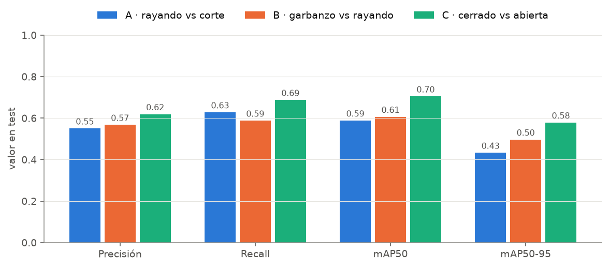

# Proyecto Flores · Fenología de rosa con dron y YOLO26

Detección y conteo de **estados fenológicos de rosa** (garbanzo, rayando color, punto de corte, flor abierta) en fotos cenitales de dron, para la **proyección de flor** en invernadero. Variedades **Freedom** (roja) y **Vainilla** (blanca).

> 📄 **Informe completo:** [INFORME.md](INFORME.md). Incluye el paso a paso, todas las métricas, tablas comparativas, matrices de confusión, curvas, ejemplos y el plan de mejora.

> ⚠️ **Fase preliminar.** Los modelos actuales se entrenaron 25 épocas con **etiquetas automáticas sin corregir**. Sus métricas sirven para comparar y validar el pipeline, **no para reportar**. La corrección manual de etiquetas está en curso.

## Resultado preliminar (test: 22 fotos de bloques no vistos)

| Modelo | Clases | Precisión | Recall | mAP50 | mAP50-95 | Decisión |
|---|---|---|---|---|---|---|
| **A** | rayando color vs punto de corte | 0,550 | 0,628 | 0,588 | 0,433 | ✅ principal |
| **B** | garbanzo vs rayando color | 0,567 | 0,588 | 0,606 | 0,496 | ✅ secundario |
| **C** | botón cerrado vs flor abierta | 0,619 | 0,687 | 0,705 | 0,579 | ❌ descartar (poco útil para proyectar) |



## Cómo funciona

1. Las fotos de dron (8064×6048) se normalizan en escala y se parten **por bloque**, para evitar fuga entre train y test.
2. **Preanotación automática** de 4 estados: YOLOE-26 con ejemplos visuales, más reglas de color con balance de blancos por vuelo.
3. **Corrección humana** en Label Studio.
4. Se derivan 3 datasets binarios, se cortan en mosaicos de 1024 px y se entrena **YOLO26s**.
5. Inferencia en la foto completa con **SAHI**, y conteo por estado.

## Estructura

```
INFORME.md            informe técnico completo
scripts/              pipeline (01–08), Label Studio, utilidades; config.yaml
resultados/           CSV de métricas, conteos, matrices e inventario
docs/figuras/         gráficas comparativas, por modelo y de la preanotación
requirements.txt
```

## Próximos pasos

1. Corregir 10 fotos semilla + val + test en Label Studio.
2. Entrenar un modelo semilla y re-preanotar el resto de fotos.
3. Pasar a un esquema de dos etapas (detector de botón + clasificador de estado), segmentar con SAM para medir el diámetro y entrenar 150 épocas.

Detalle en [INFORME.md §10](INFORME.md#10-lo-que-falta-y-plan-para-mejorar-el-modelo).
